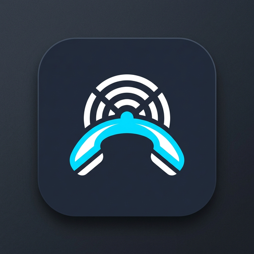

<p align="left">
  
</p>

# CallBridge

Get a native macOS notification the instant your Android phone rings.
No cloud, no accounts. Your call metadata never leaves your Wi-Fi network.

```
[Android rings] --HTTP POST--> [Mac listener] --> [macOS notification]
```

## Why

Existing solutions (Pushbullet, KDE Connect) are either cloud relays that
see your call metadata, or full device-suites when you only wanted call
alerts. CallBridge does exactly one thing:

- **Android**: a `BroadcastReceiver` notices an incoming call and POSTs a
  tiny JSON event to your Mac over your local network.
- **Mac**: a small app shows the same event as a native notification —
  and displays a QR code so pairing takes one scan.

That's the whole system. The entire wire protocol fits on one page — see
[PROTOCOL.md](PROTOCOL.md). The only dependencies are Apple's system
frameworks (Mac) and Google's AppCompat/Material/CameraX/ML Kit (Android);
QR scanning runs entirely on the phone.

## Requirements

- Android 8.0+ (Oreo) phone
- macOS 12+ (Monterey)
- Both devices on the same Wi-Fi network
- Swift 5.9+ toolchain to *build* the Mac app (users of a release don't need it)

## Setup (from source)

### 1. Mac — build and open the app

```bash
cd mac
./make_app.sh
open build/CallBridge.app
```

The window shows the address it's listening on, a QR code, and the three
pairing steps. (Terminal-only mode still works:
`.build/release/callbridge --headless --port 8765`.)

### 2. Android — install and pair

1. Open the `android/` folder in Android Studio and press Run, or build
   the APK from CI releases and sideload it.
2. Grant the phone-state permission when asked.
3. Tap **Scan QR code** and point the camera at the code on your Mac.
   (Manual entry stays available under *Enter address manually*.)
4. Tap **Send test** — a notification should appear on your Mac.

### 3. Done

When someone calls your Android, your Mac now shows:
"Incoming call · +1 555 010 1234".

Optional: set a shared secret on the Mac (Connection settings) and re-scan
the QR so only your phone can post notifications to it.

## Security model

Honest about what this is: LAN-only, plaintext HTTP, optional shared
secret header (`X-CallBridge-Secret`). It is designed for home networks,
not hostile ones. Nothing is stored, logged, or sent anywhere except your
own Mac.

## Releases

Prebuilt binaries are attached to every [GitHub release](https://github.com/thepushkaraj/CallBridge/releases):

- **Android**: `CallBridge-vX.Y.Z.apk` — sideload it (Android asks to allow installs from your browser once)
- **macOS**: `CallBridge-macOS.zip` — unzip, drag to Applications. The first launch needs one approval (the app is not Apple-notarized): double-click it once — if macOS blocks it, choose **Done**, then open **System Settings → Privacy & Security** and click **Allow Anyway** next to the CallBridge message. This is only needed once.

Already installed? The app checks GitHub on launch and offers the update in-app — or use **Check for updates** in the app. ([latest release](https://github.com/thepushkaraj/CallBridge/releases/latest)) One-time note: if you installed the v0.3.0 **Android** APK, uninstall it once before installing v0.3.1 or newer (the app switched to its permanent release signature in v0.3.1).

| Release | Highlights |
|---|---|
| [v0.3.1](https://github.com/thepushkaraj/CallBridge/releases/tag/v0.3.1) | Android fix release: updater points at the real GitHub API, APK is release-signed |
| [v0.3.0](https://github.com/thepushkaraj/CallBridge/releases/tag/v0.3.0) | In-app auto-updater, manual update checks, release-signed Android builds |
| [v0.2.0](https://github.com/thepushkaraj/CallBridge/releases/tag/v0.2.0) | QR-code pairing, Material redesign, new app identity |
| [v0.1.0](https://github.com/thepushkaraj/CallBridge/releases/tag/v0.1.0) | Call notifications to your Mac |

## Roadmap

- [x] v0.1 — ringing notifications, manual IP entry
- [x] Mac `.app` with QR-code pairing *(this release)*
- [ ] Missed-call events
- [ ] mDNS auto-discovery (no manual IP entry)
- [ ] Signed DMG + APK releases
- [ ] Windows / Linux listeners speaking the same protocol

## Contributing

Start with [PROTOCOL.md](PROTOCOL.md) — the whole spec is one JSON blob.
Pick a platform folder; there are no cross-platform abstractions to learn.

## License

[MIT](LICENSE)
